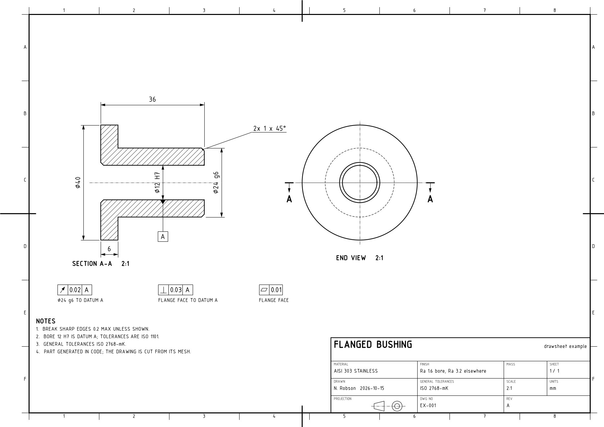
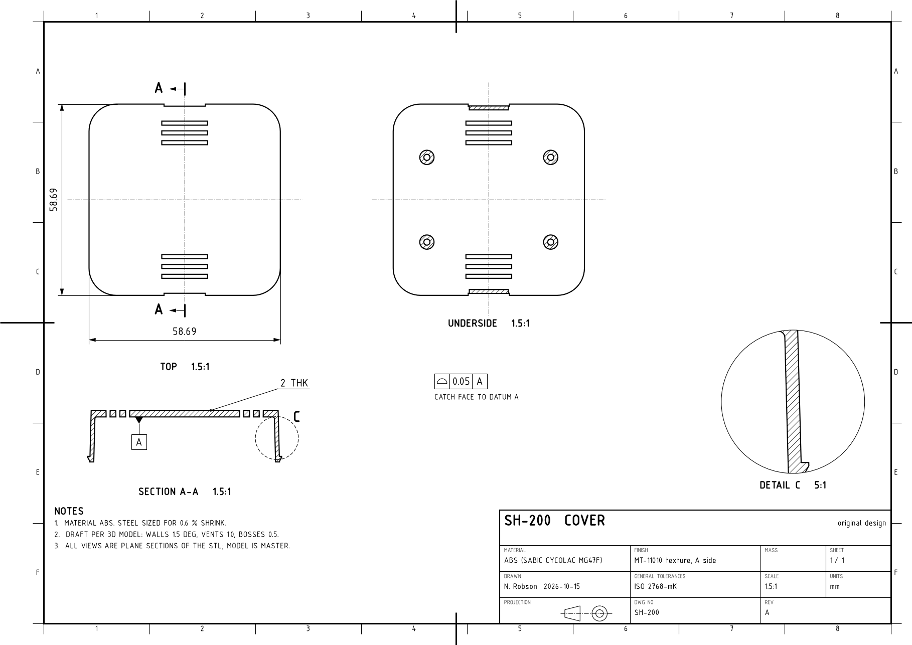

# cad-drawing-generator

`drawsheet` is a small Python library for engineering drawing sheets. It builds
ISO-style sheets in code: frame, title block, views cut from the part's own
geometry, dimensions and geometric tolerances. Output is a vector PDF or SVG,
or a PNG.

It exists because Fusion's drawing API stops short: it can create a sheet, its
base views and an automatic dimension pass, but not section or detail views,
dimensions you place, or feature control frames. Drawings for jobs that repeat (a
part family, a revision, a sheet regenerated after a model change) are faster and
more consistent when the sheet is a script.



*`examples/flanged_bushing.py`: the part is generated as a mesh from its turned
profile. Section A-A and the end view are cut from that mesh. Datum A is the
bore axis, with circular runout, perpendicularity and flatness frames.*

## What it does

| Module | Contents |
|---|---|
| `sheet` | A4 to A1; ISO 5457 frame (20 mm filing margin, zones close to 50 mm long, centring marks); ISO 7200 title block; first or third angle projection symbol; numbered notes; save to PDF, SVG or PNG |
| `view` | Model to paper mapping (axes, scale, mirroring); visible outlines; sections with 45° hatching clipped to the exact cut face, holes included; hidden lines; centre lines and marks; cutting-plane lines with view arrows; detail views clipped to a circle |
| `dims` | Linear (horizontal, vertical, aligned), diameter, radius, leaders and notes; basic (boxed) dimensions; ± and deviation tolerances such as `24 -0.007/-0.020` for a g6 shaft (both deviations to the same decimals). The value printed is the model size, whatever the view scale |
| `gdt` | Feature control frames for all 14 ISO 1101 characteristics, diameter zones, M or L modifiers, and datum feature symbols. Orientation, runout, concentricity and symmetry frames are refused without a datum; position may stand alone |
| `mesh` | STL reader (ASCII and binary) and plane sections returning outer and hole loops, so any part exported from CAD can be drawn |

Line widths are ISO 128 style: 0.7 mm frame and section-line ends, 0.5 mm
visible outlines, 0.25 mm dimensions and leaders, 0.18 mm centre lines and hatching.
Text heights are capital heights in mm. If an ISO 3098 font (osifont, DS ISO 1,
ISOCPEUR) is installed it is used; otherwise DejaVu Sans. Frames, leaders and
shelves are sized from the rendered width of the text in that font, so they fit
whichever font is in use.

All GD&T symbols are drawn as lines rather than taken from a font. They look the
same on any machine and in any output format, which is not true of the Unicode
symbol characters.

## A real part



*`examples/snap_fit_cover.py`: the cover of an injection-moulded snap-fit
housing (my own design, generated by `snap_fit_housing.py` in the
[fusion360-parametric-parts](https://github.com/nrobson3/fusion360-parametric-parts)
repo), drawn from its STL export:*
- *every view is a plane section of the mesh;*
- *the overall size and the wall thickness are measured from those sections, not typed in;*
- *detail C is a 5:1 view of a snap arm, clipped to its circle.*

## How it works

- **Sections from a mesh.** The mesh is cut by a plane triangle by triangle.
  Every cut point lies on a mesh edge and is named by that edge, so the two
  faces sharing it meet at exactly the same point. No distance tolerance decides
  which points join, so loops a fraction of a micron apart stay apart.
- **Outer boundaries and holes.** Each cut segment is directed by its face's
  outward normal, so every loop runs with the material on its left. Counter-
  clockwise loops are outer boundaries and clockwise loops are holes. Each hole
  goes to the smallest outer boundary that most of its points lie inside. This
  handles islands inside holes, and bodies that touch at a corner or along a
  face.
- **Hatching that respects holes.** Outer rings are wound counter-clockwise and
  holes clockwise, so matplotlib's nonzero fill rule leaves holes empty. The
  hatch lines are clipped to that same path.
- **Hatching in detail views.** An artist takes only one clip path, so the cut
  face is first clipped to the detail circle geometrically (Sutherland–Hodgman),
  and that shape is hatched. This works because (A − H) ∩ C = (A ∩ C) − (H ∩ C).
- **Fine meshes.** Curved edges come out as straight chords of the mesh, so
  export the STL at a fine refinement. Chord error on the mesh is chord error on
  the sheet.
- **Which way a section looks.** `mesh.section(normal=n)` is seen from the +n
  side looking along −n. A cutting-plane line's arrows must therefore point
  along −n as it appears in the view the line is drawn on. Both examples say
  which way theirs point and why.
- **Gaps in the mesh.** A chain of cut segments that never closes means the mesh
  has a gap there. It is dropped with a warning rather than closed with a
  made-up edge. Cut a little inside the material rather than exactly on a face.

## Use

```python
from drawsheet import Sheet, View, dims, gdt, mesh

tris = mesh.read_stl('part.stl')
sheet = Sheet('A3', title='BRACKET', number='BR-001', scale='1:1', material='6061-T6')
front = View(sheet, centre=(120, 180), scale=1.0)
front.section(mesh.section(tris, origin=(0, 0, 5), normal=(0, 0, 1)))
dims.linear(front, (-30, 0), (30, 0), offset=-20, direction='h')
gdt.feature_control_frame(sheet, 40, 60, 'position', '0.1', datums=('A', 'B'), diameter=True)
sheet.save('bracket.pdf')
```

Run the examples and the tests from the repository root:

```
python examples/flanged_bushing.py
python examples/snap_fit_cover.py path/to/cover.stl
python -m unittest discover tests
```

The tests cover:
- section areas against the analytic values;
- hole nesting;
- the right-handed plane basis;
- STL reading in both formats;
- dimension values at several scales;
- the tolerance formats;
- every GD&T symbol;
- that each output format writes.

## Requirements

Python 3.9 or newer, with numpy and matplotlib.

## Limits

- There is no hidden-line removal for general 3D views. Views are sections or
  silhouettes from sections, which suits prismatic and turned parts.
- Dimension placement is manual: you choose the offsets.
- A mesh whose faces are not consistently wound is cut ignoring direction, and
  its loops are nested by containment instead; a warning says so.

## License

MIT. See [LICENSE](LICENSE). Copyright (c) 2026 Navy Robson.
